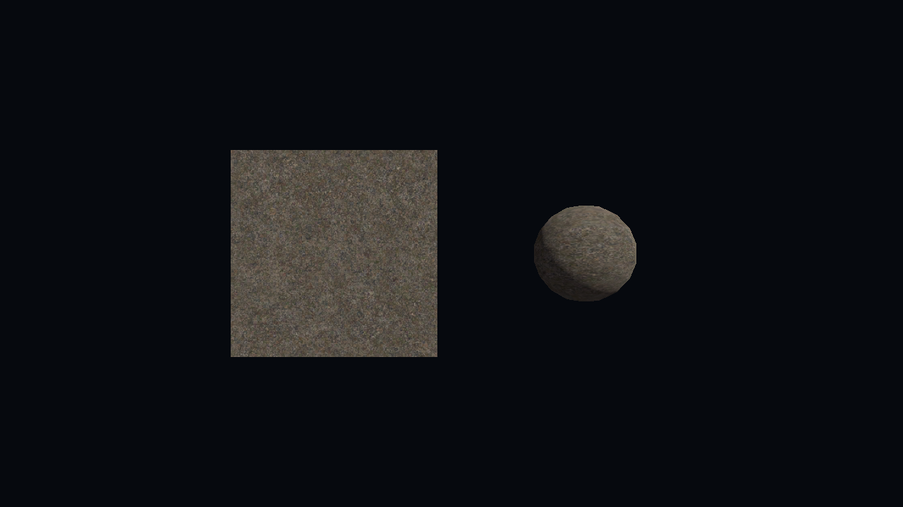
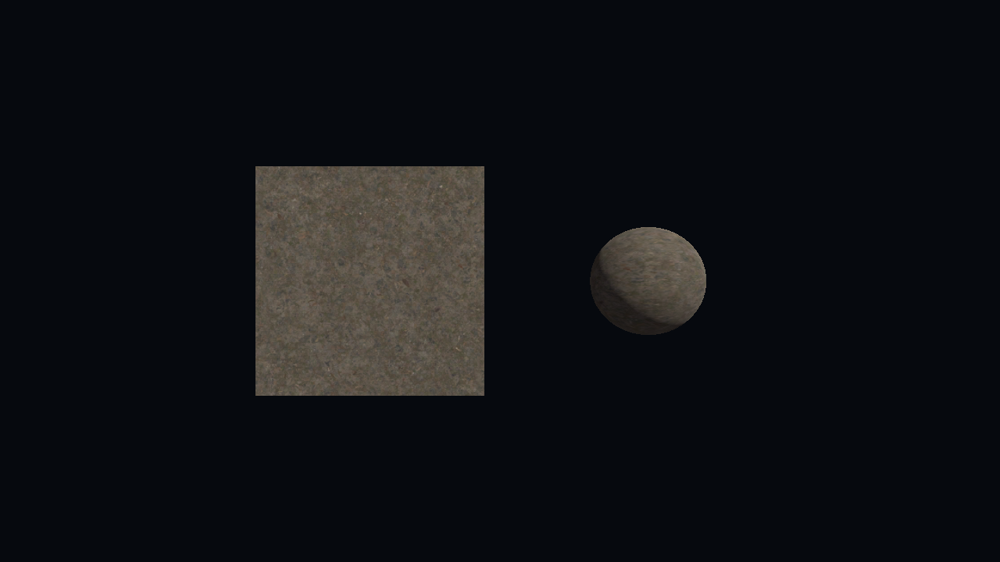

# F1-20: portão obrigatório do ADR-0016

**Resultado: o portão PASSOU nos três tipos.** Em Godot 4.7.2 estoque, um `ResourceFormatLoader` registrado por GDExtension materializou, a partir de **bytes servidos pelo mock do `sw-core`**, sem `FileAccess` e sem o loader nativo:
1. uma **textura BC1 (DXT1) 4096×4096 com 12 níveis de mip**;
2. uma **malha com 2 LODs** (170 e 8 514 vértices);
3. um **áudio OGG** de 3 s.

Nos três casos, o recurso foi trocado **no mesmo objeto**, na **thread principal**, quando o dado melhor chegou. A decisão 1 do [ADR-0016](../adr/0016-ponto-de-intercepcao-godot.md) (caminho A) fica de pé: nenhum tipo cai para o caminho B (`.pck` por grupo).

Sessão Arquiteto (R1), 2026-10-19. É só o portão; o resto da F1-20 (o mapa de teste carregando pelo loader) não está aqui.

## Ambiente

| Item | Valor |
| --- | --- |
| Máquina | Windows 11, NVIDIA GeForce GTX 1050 Ti |
| Godot | 4.7.2-stable, `Godot_v4.7.2-stable_win64_console.exe`, renderizador GL Compatibility; `RenderingServer.has_os_feature("s3tc")` = `true` |
| godot-cpp | tag `godot-4.5-stable` (o mesmo do spike F0; a extensão declara `compatibility_minimum = "4.5"`) |
| Compilador | GCC 16.2 (MinGW-w64, WinLibs), CMake + Ninja, Debug |
| Textura de origem | `rock_path_diff_8k.jpg` do mapa (Poly Haven, CC0) |
| Malha e áudio | **Sintéticos**: o mapa não tem malhas nem áudio. Esfera do `SphereMesh` em 128×64 e 16×8 segmentos; tom de 440 Hz por 3 s, gerado com `ffmpeg` (`libvorbis`) |

## O que foi provado (4 rodadas com janela + 1 headless, todas `PASSOU (38 linhas)`)

| Critério | Evidência (rodadas 1 a 4 com janela) |
| --- | --- |
| Bytes vêm do mock, não do disco do jogo | Os arquivos ficam no `MemoryContentSource` (a "CDN" do mock, com 600 ms de latência por peça); o loader lê só pelo adaptador. `FileAccess.file_exists("swarm://gate/rock_4k.swtex")` = `false` e `FileAccess.open` = `null` |
| Sem `FileAccess` no loader | Nenhuma chamada a `FileAccess` em `sw-godot/extension/src/`. O loader não delega: constrói o recurso por `Image.create_from_data` + `ImageTexture`, `ArrayMesh.add_surface_from_arrays` e `AudioStreamOggVorbis.load_from_buffer` |
| Textura BC1 4K com mips | Depois da troca: 4096×4096, formato 17 (`FORMAT_DXT1`), 12 níveis de mip; 11 184 824 bytes em 11 peças de 1 MiB. Antes da troca: 256×256 do grupo core (8 mips, 43 704 bytes) |
| Malha com 2 LODs | LOD 1 (core) com 170 vértices e LOD 0 com 8 514 vértices, trocados na mesma `ArrayMesh` |
| Áudio OGG | Entregue vazio (sem pacotes, "começa atrasado", 06 §Política de falta) e depois com 3,00 s; `AudioStreamPlayer` tocando, com a posição avançando para 0,47–0,56 s, **no driver de áudio falso** (ver "O que NÃO foi provado", item 1) |
| `_load` nunca espera a rede | `_load` rodou em thread de worker (`load_threaded_request`) e durou **4,8–7,1 ms** (textura), **0,9–1,7 ms** (malha) e **0,3–1,2 ms** (áudio). A latência da fonte era de 600 ms, e o recurso ficou pronto em 6,7–11,4 ms. A leitura do melhor nível deu `SW_E_NOT_LOCAL` nos três |
| Troca no lugar, na thread principal | As três trocas rodaram em `MAIN` (via `call_deferred`) e no **mesmo** `instance_id` entregue pelo `ResourceLoader`; depois da troca, `ResourceLoader.load()` devolve o objeto já trocado. Espera até a troca: 739–759 ms (textura, 11 peças), 618–673 ms (malha), 618–632 ms (áudio) |
| Visual | Capturas antes/depois (rodada 4): [antes](f1-20-portao-antes.png), [depois](f1-20-portao-depois.png). A esfera passa de facetada (LOD 1) a lisa (LOD 0), e a textura muda de nível |

 

## Como foi feito

```
GDScript (cena do portão)
  └─ ResourceLoader.load_threaded_request("swarm://gate/...")
        └─ SwarmLoader._load (worker)          ── sw-godot/extension/src/swarm_loader.cpp
              ├─ read(melhor nível)  ─► SW_E_NOT_LOCAL na hora, pedido de rede feito
              ├─ read(nível do core) ─► constrói o recurso a partir dos bytes
              └─ ensure_async(melhor) ─► callback numa thread do adaptador
                    └─ monta Image / arrays / OggPacketSequence (fora da thread principal)
                    └─ call_deferred ─► troca no MESMO objeto, na thread principal
GateCore (adaptador, semântica do swarmstream.h v0)   ── src/gate_core.*
  ├─ MemoryContentSource (mock da CDN, latência simulada)
  └─ MemoryCacheStore (cache; leases presos até o release, como no sw_close)
```

- **Por que um adaptador:** o `swarmstream.h` congelado ainda é stub (`SW_E_NOT_IMPLEMENTED`). O `GateCore` imita a semântica dele (`timeout_ms = 0` → `SW_E_NOT_LOCAL` com o pedido feito; `sw_ensure_async` com callback exatamente uma vez, fora da pilha da chamada, e leases até o `release`) sobre os mocks do `sw-core`. Quando o `sw-core` real existir, o loader troca as chamadas do `GateCore` pelas funções `sw_*`. **Nada faltou no contrato** para o portão.
- **Exceções:** o `godot-cpp` propaga `-fno-exceptions`, e os mocks do `sw-core` usam exceções (`Result::value`). Por isso o adaptador compila numa biblioteca estática separada, com um cabeçalho sem exceções.
- **Formatos `.swtex`/`.swmesh`** (`src/gate_formats.h`): provisórios e legíveis por bytes, com cada limite conferido. O `sw-pack` vai exportar os tipos pesados num formato assim (ADR-0016, "Materialização"). Quem os gera aqui é `scripts/gate_pack.gd`, que faz o papel do `sw-pack` e pode usar `FileAccess`, porque roda na build.
- **Nível do core:** o loader acha o mip/LOD baixo pela convenção de nome `X.low.ext`. Ver pendência 3.

## Reproduzir

```bash
cmake -S sw-godot/extension -B build-godot -G Ninja -DCMAKE_BUILD_TYPE=Debug -DGODOT_CPP_DIR=<godot-cpp godot-4.5-stable>
cmake --build build-godot
python sw-godot/tools/gate_f1_20.py --godot <Godot_v4.7.2-stable_win64_console.exe> --out <pasta>
python sw-godot/tools/gate_f1_20.py --godot <...> --headless
```
O primeiro build do `godot-cpp` levou 18 min nesta máquina; os seguintes, segundos.

**Testes no CI** (sem Godot): `sw-godot/extension/tests/` entra no build da raiz como `sw-godot-gate-core`, com 24 conferências do adaptador e dos formatos: `NOT_LOCAL` sem esperar a latência, callback exatamente uma vez com o id certo, bytes idênticos depois do ensure, leitura que cruza peças e recusa de formatos malformados. Localmente: `ctest` 3 de 3.

## O que NÃO foi provado

1. **Que o som sai.** Nesta máquina, o WASAPI falhou ao iniciar em **todas** as execuções (`InitializeSharedAudioStream` e depois `Initialize` com `0x8889000F`), e o Godot caiu no driver de áudio falso (`Dummy`). A cena registra o driver em uso (`driver_de_audio=Dummy`). O que está provado é que o OGG decodifica e o mixer do Godot o reproduz; não está provado que o som chega ao dispositivo. Provável causa: o dispositivo de áudio da máquina, não o loader. Fica para o diagnóstico. **O dono do produto precisa abrir a cena e ouvir** (`godot --path sw-godot/project res://scenes/gate_f1_20.tscn`), como o docs/17 já previa.
2. **Export** com `template_release`, **Linux/macOS** e **MSVC** (a extensão só foi compilada com MinGW; a parte testada no CI compila nos dois).
3. **O `sw-core` real**: o portão usa o adaptador sobre os mocks.
4. **Malha e áudio do mapa**: os dois são sintéticos, porque o mapa só tem texturas.
5. **A segunda parte da F1-20**: o mapa de teste carregando pelo loader e a medição de que o `_load` nunca espera a rede durante a rota.

## Pendências que este portão abriu (para os próximos cartões)

1. **Formato dos tipos pesados exportados pelo `sw-pack`** (`.swtex`/`.swmesh` provisórios): definir antes da F1-21/F1-22 (ADR ou seção no doc 06), porque vira contrato entre `sw-pack` e `sw-godot`.
2. **O loader reaproveita a extensão `.ogg`:** só reivindica `swarm://gate/**`, então os `.ogg` do projeto continuam com o loader nativo. Para o mapa real, o prefixo reivindicado tem de ser decidido com cuidado (o spike mostrou que, dentro do prefixo, o loader substitui o importador).
3. **"Onde está o nível do core de X"**: hoje é a convenção `X.low.ext`. No produto, isso precisa vir do manifesto ou do `sw-pack` (grupo `core` + relação "mip/LOD baixo de X"), e entra com a F1-05/F1-07.
4. **O adaptador traz o arquivo inteiro** (até 11 MB por textura 4K). A F1-21 deve medir se vale pedir os mips por faixa.
